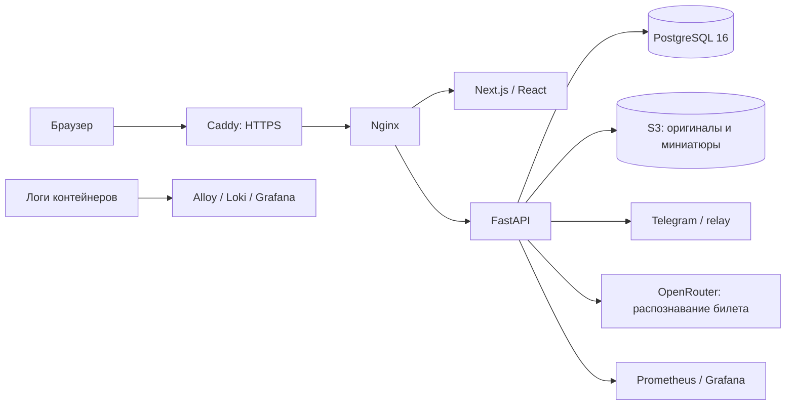

# TravelHub / Dotty

Проект команды 11 для хакатона: поездки, карта маршрута, дневной таймлайн, активности и перемещения, фотографии и билеты. Backend также поддерживает проверку расписания, роли участников, Telegram-напоминания и распознавание билетов через OpenRouter. API распознавания пока не подключён к форме билета; ограничения перечислены ниже.

- [Приложение](https://hack-kzn-11-vm1-5798eb.vm.prodcontest.com)
- [Swagger](https://hack-kzn-11-vm1-5798eb.vm.prodcontest.com/api/docs)
- [OpenAPI](https://hack-kzn-11-vm1-5798eb.vm.prodcontest.com/api/openapi.json)
- [Grafana](https://hack-kzn-11-vm1-5798eb.vm.prodcontest.com/grafana/)

## Архитектура



Backend — слоистый монолит: `routers` → `services` → `repositories`. Данные проверяются Pydantic и ограничениями PostgreSQL, схема версионируется Alembic. Frontend: Next.js App Router, TypeScript, FSD, React Query, axios, react-hook-form и Zod. Монолит упрощает транзакции и развёртывание в условиях хакатона.

| Каталог | Назначение |
|---|---|
| `backend/src` | API, бизнес-логика, модели, хранилище |
| `backend/migrations`, `backend/tests` | Миграции и тесты |
| `backend/docs` | Документация API и уведомлений |
| `frontend/app`, `frontend/src` | Маршруты Next.js и слои FSD |
| `deploy` | Единый Compose для локального запуска и production, прокси, мониторинг, эксплуатация |

## Локальный запуск

Нужны Python 3.13+ (Docker/CI — 3.14), Node.js 24, pnpm из `frontend/package.json`, Docker Engine и Compose v2. Для изображений создать закрытый S3-совместимый bucket и ключи с правами чтения, записи и удаления объектов.

### Весь проект через единый Compose

Из корня репозитория:

```sh
cp backend/.env.example deploy/.env
# Заполнить deploy/.env: SECRET_KEY, S3_ACCESS_KEY, S3_SECRET_KEY.
# Для локального запуска оставить COMPOSE_PROFILES пустым/отсутствующим.
# CORS_ORIGINS=http://localhost:8080,http://localhost:3000
# FRONTEND_URL=http://localhost:8080
# TELEGRAM_REDIRECT_URI=http://localhost:8080/api/auth/telegram/callback
# Создать frontend/.env с публичными ключами карт (см. ниже),
# NEXT_PUBLIC_API_BASE_URL оставить пустым для общего nginx.
docker compose --env-file deploy/.env -f deploy/docker-compose.yaml up --build -d --wait --wait-timeout 180
```

Приложение: `http://localhost:8080`, Swagger: `http://localhost:8080/api/docs`.
Backend напрямую: `http://localhost:1984`; frontend: `http://localhost:3000`.
Порт backend внутри этого Compose всегда 1984, PostgreSQL — 5432.
Флаг `--env-file` нужен также для подстановки реквизитов в сервис PostgreSQL:
один `env_file` внутри сервиса не задаёт переменные самого Compose.
Не запускайте одновременно этот стек и `backend/docker-compose.yml` на тех же портах.

Профиль `prod` добавляет Caddy и мониторинг; CI записывает `COMPOSE_PROFILES=prod`
в `.env` на VM. На локальной машине они по умолчанию выключены.

### Backend отдельно

```sh
cd backend
cp .env.example .env
# Заполнить SECRET_KEY и S3_ACCESS_KEY / S3_SECRET_KEY.
docker compose up --build -d
```

В PowerShell вместо `cp` можно использовать `Copy-Item .env.example .env`.

Backend: `http://localhost:8080`; Swagger: `/api/docs`; liveness: `/api/ping`; readiness с проверкой БД: `/api/ready`. Контейнер применяет миграции до старта сервера. При изменении `SERVER_PORT` изменить и frontend-конфигурацию.

Запуск Python без контейнера приложения, после подготовки `.env`:

```sh
cd backend
python -m venv .venv
# Linux/macOS: source .venv/bin/activate
# PowerShell: .\.venv\Scripts\Activate.ps1
pip install -r requirements.txt
docker compose up -d db
alembic upgrade head
python -m src.main
```

Для этого режима оставить `POSTGRES_HOST=localhost`.

### Frontend

Создать `frontend/.env.local`:

```dotenv
NEXT_PUBLIC_API_BASE_URL=http://localhost:8080
NEXT_PUBLIC_YANDEX_MAPS_API_KEY=<публичный ключ JavaScript API карт>
NEXT_PUBLIC_YANDEX_SUGGEST_API_KEY=<публичный ключ подсказок>
NEXT_PUBLIC_YANDEX_GEOCODER_API_KEY=<публичный ключ геокодера>
NEXT_PUBLIC_YANDEX_SEARCH_API_KEY=<публичный ключ поиска организаций>
```

```sh
cd frontend
corepack enable
pnpm install --frozen-lockfile
pnpm dev
```

Открыть `http://localhost:3000`. API URL указывается без `/api`; для production за общим прокси используется пустое значение. `NEXT_PUBLIC_*` задаются **до сборки** и не должны содержать серверные секреты. Ключи карт ограничить разрешёнными доменами у провайдера.

### Настройки backend

Полный пример — [backend/.env.example](backend/.env.example).

| Переменные | Назначение |
|---|---|
| `POSTGRES_USERNAME`, `POSTGRES_PASSWORD`, `POSTGRES_HOST`, `POSTGRES_PORT`, `POSTGRES_DATABASE` | PostgreSQL |
| `SECRET_KEY`, `JWT_ALGORITHM`, сроки токенов | Авторизация |
| `CORS_ORIGINS`, `COOKIE_SECURE`, `COOKIE_SAMESITE`, `COOKIE_DOMAIN` | Origin и cookies; при production HTTPS включить secure cookies |
| `S3_ENDPOINT_URL`, `S3_REGION`, `S3_BUCKET`, `S3_ACCESS_KEY`, `S3_SECRET_KEY` | Закрытое S3-хранилище; bucket создать заранее |
| `SEED_DEMO_USERS` | Демонстрационные аккаунты |
| `TELEGRAM_CLIENT_ID`, `TELEGRAM_CLIENT_SECRET`, `TELEGRAM_REDIRECT_URI`, `FRONTEND_URL` | OAuth Telegram |
| `TELEGRAM_BOT_TOKEN`, `TELEGRAM_NOTIFICATIONS_ENABLED`, `TELEGRAM_RELAY_URL` | Напоминания и relay; пустой relay означает прямой API; значение по умолчанию требует отдельной проверки |
| `OPENROUTER_API_KEY`, `TICKET_MODEL` | Серверный ключ и модель распознавания; без ключа API возвращает 503 |

При `SEED_DEMO_USERS=true` создаются `user1@gmail.com` … `user7@gmail.com`, пароли `user1pass` … `user7pass`. Это общедоступные демонстрационные аккаунты; не хранить в них реальные закрытые материалы. Наполненная поездка автоматически не создаётся.

## Проверки

```sh
cd frontend
pnpm check   # typecheck + lint, без изменения файлов
pnpm build   # production build
```

`pnpm lint:fix` — отдельная команда для явного исправления форматирования.

```sh
cd backend
pip install -r requirements.txt
python -m pytest -q
```

Нужны настройки и `SECRET_KEY` из `.env`. Testcontainers по умолчанию создаёт отдельную PostgreSQL 16; S3 заменяется Moto. Для уже созданной **отдельной тестовой** БД задать `PYTEST_USE_TESTCONTAINERS=0` и `POSTGRES_*`. Тесты очищают таблицы — production БД использовать нельзя. Даты ОС и PostgreSQL должны соответствовать одному календарному дню; CI работает в UTC.

Проверяются CRUD, приватность, вложения, повторы запросов, изменение дат поездки и readiness при отказе БД. Миграции применяются к новой БД. `alembic heads` должен показывать одну вершину.

## Данные и доступ

- Поездки закрыты по умолчанию. Роли: `owner`, `editor`, `viewer`; изменение поездки доступно владельцу.
- Событие — активность или перемещение. Нельзя использовать места чужой поездки и удалять используемые места.
- Сокращение дат проверяется backend под блокировкой поездки: события не должны остаться вне новых границ. Модель часового пояса поездки требует отдельной доработки.
- Создание поездок, мест и событий поддерживает `client_request_id` (UUID). Frontend сохраняет один UUID для повторов того же тела в открытой форме после ошибки; после успеха или изменения тела создаёт новую операцию. При закрытии формы/перезагрузке UUID не сохраняется. API-клиент при повторе должен использовать UUID исходной операции.
- Повтор загрузки того же выбранного файла в галерее сохраняет UUID до успеха. Форма билета использует отдельные ключи для события и фото; ошибка фото показывается пользователю, повтор с теми же данными не создаёт второе событие.
- При выходе и успешном входе отменяются запросы, очищается React Query cache и перезагружается страница, чтобы пересоздать также активные наблюдатели запросов.
- JPEG/PNG хранятся в S3; оригиналы и миниатюры доступны через защищённый API. Размер, число пикселей и вложений ограничены настройками backend.

См. [API данных](backend/docs/travelhub-data-api.md) и [уведомления](backend/docs/notifications.md).

## CI/CD и эксплуатация

GitLab: backend-тесты → сборка образов → деплой `main`. Frontend-проверки обязательны в Docker-сборке. Ошибки публикации образа, включая конфликт тега, не превращаются в успех. Тег содержит commit и pipeline ID.

| CI/CD variable | Назначение |
|---|---|
| `SPIRIT_DOCKER_SA_KEY` | File variable: ключ service account registry |
| `SSH_PRIVATE_KEY` | Закрытый SSH-ключ VM |
| `BACKEND_ENV` | File variable: production `.env` |
| `FRONTEND_ENV` | File variable либо текст dotenv с публичными `NEXT_PUBLIC_*`; применяется при сборке и передаётся на VM как `frontend.env` |
| `TELEGRAM_BOT_TOKEN` | Необязательное переопределение токена из `BACKEND_ENV`; флаг `TELEGRAM_NOTIFICATIONS_ENABLED` задаётся в `BACKEND_ENV` |
| `DEPLOY_VM`, `DEPLOY_SSH_USER`, `DEPLOY_URL` | VM, пользователь, публичный HTTPS URL; значения по умолчанию в CI |

На VM нужны Docker, Compose v2 с поддержкой `env_file.required` и `up --wait`, доступ к registry/S3, открытые 80/443 и DNS. Production compose задаёт backend-порт 1984 и внутренний PostgreSQL-порт 5432. Порты PostgreSQL, backend и frontend доступны только через loopback VM; публичный вход — Caddy.

`FRONTEND_ENV` одинаково обрабатывается для сборки и деплоя: файл копируется, текст записывается как dotenv. Если переменная не задана, используется пустой файл, чтобы не сохранять настройки предыдущего релиза. Для изменения `NEXT_PUBLIC_*` нужна новая сборка; одного изменения `frontend.env` на VM недостаточно.

Деплои сериализованы через `resource_group: production`. До замены релиза сохраняются конфигурация и дамп БД. После запуска CI ждёт readiness и проверяет публичный HTTPS. Автоматический откат БД не выполняется.

**Инструкции:** [релиз, откат, резервное копирование и восстановление](deploy/OPERATIONS.md).

## Наблюдаемость

JSON-логи содержат `request_id`, метод, путь, статус и длительность. Внутренний `/metrics` экспортирует HTTP-метрики. Prometheus, node-exporter, Loki, Alloy и Grafana собирают метрики и логи. Есть правила алертов для недоступности backend, 5xx, задержки, CPU, памяти и диска. Доставка алертов внешним получателям отдельно не настроена.

См. [мониторинг](deploy/monitoring/README.md).

## Известные ограничения MVP

- Распознавание билетов реализовано в API, но форма пока заполняется вручную.
- OAuth Telegram не проверяет подпись `id_token`; relay по умолчанию использует HTTP. Требуется отдельное исправление перед использованием с реальными аккаунтами.
- Приглашение участников не завершено.
- Рекомендации — случайный выбор из каталога, а не поиск поблизости.
- Единая модель часовых поясов поездки не реализована.
- Внешнее хранение резервных копий, резервирование S3 и доставка алертов требуют настройки инфраструктуры.
