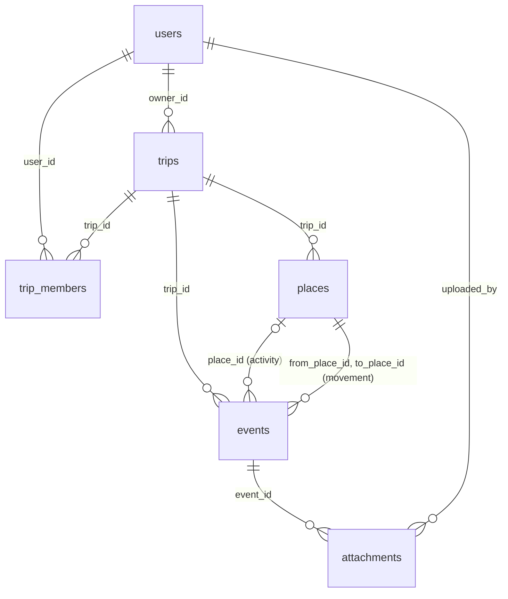

# TravelHub — спецификация слоя данных

| | |
|---|---|
| **Версия** | 2.0 · 2026-11-07 |
| **Статус** | Утверждается. После утверждения — источник правды для моделей, миграции и сервисов поездок |
| **Заменяет** | модель `f3a91c6e2b48` в `main`, модель `3b2e47c160b3` в `feature/add_database`, travelhub-data-api.md v1 |
| **Основание** | ТЗ «TravelHub — путешествие как история», разделы 5, 8 и 10 |
| **Для кого** | Разработчики backend: модели, миграции, сервисы, эндпоинты |

## Содержание

0. [Коротко](#0-коротко)
1. [Границы MVP](#1-границы-mvp)
2. [Модель данных](#2-модель-данных)
3. [Бизнес-правила](#3-бизнес-правила)
4. [Доступ](#4-доступ)
5. [Сервисный API](#5-сервисный-api)
6. [Ошибки](#6-ошибки)
7. [Файлы](#7-файлы)
8. [Транзакции и производительность](#8-транзакции-и-производительность)
9. [План внедрения](#9-план-внедрения)
10. [Приёмочные тесты](#10-приёмочные-тесты)
11. [Открытые вопросы](#11-открытые-вопросы)
- [Приложение A. DDL](#приложение-a-ddl)

---

## 0. Коротко

- **Поездка** содержит **места** и **события**. Таймлайн — это события поездки, отсортированные по `(start_at, id)`.
- **Место** принадлежит поездке, у него обязательные координаты, и одно место могут использовать много событий.
- **Событие** бывает двух типов в одной таблице `events`:
  - `activity` — экскурсия, проживание, ресторан, встреча и т. п., с необязательным местом;
  - `movement` — перемещение из места A в место B.

  Какие поля обязательны для каждого типа, проверяет CHECK в БД.
- **Вложения** — JPEG/PNG до 10 МБ, к ним всегда делается миниатюра. Файлы лежат в docker volume и отдаются только после проверки доступа.
- Ссылки между разными поездками запрещает БД через составные FK. Повторная отправка формы не создаёт дублей благодаря `client_request_id`.

---

## 1. Границы MVP

| Входит | Не входит |
|---|---|
| Свои поездки: создание, изменение, удаление | Приглашения, управление участниками, передача владения |
| Места: CRUD, координаты выбираются на карте | Геокодирование, поиск мест через внешние сервисы |
| События `activity` и `movement` | Построение маршрута по дорогам, расчёт времени в пути |
| Фильтр таймлайна по дню в часовом поясе поездки | Определение часового пояса по координатам |
| Загрузка JPEG/PNG к событиям, миниатюры | PDF и документы, внешние хранилища (S3, iCloud, Google Photos) |
| Обложка из готового набора (`cover_url`) | Загрузка своей обложки |
| Основа для общего доступа: таблица `trip_members`, чтение ролей | — |

---

## 2. Модель данных

### 2.1. Схема



Пример: поездка СПб → Казань.

```text
Места:    [1] Пулково   [2] Аэропорт Казань   [3] Гостиница «Татарстан»   [4] Кремль

События:  movement  «Перелёт»      1 → 2   plane   10.06 08:00–09:30
          movement  «Такси»        2 → 3   car     10.06 11:30–12:15
          activity  «Заселение»    @3      accommodation
          activity  «Экскурсия»    @4      excursion   + 3 фото, билет
          activity  «Ужин»         —       restaurant  (без места, только в таймлайне)
          activity  «Выезд»        @3      accommodation   ← то же место, что заселение
```

### 2.2. Перечисления

В БД это строки с именованным CHECK (не PostgreSQL enum). В схемах — `Literal`, чтобы OpenAPI отдавал фронтенду точные значения.

| Перечисление | Значения | Соответствие ТЗ |
|---|---|---|
| `event_type` | `activity`, `movement` | п. 5.3 перемещения, п. 5.4 события |
| `activity_category` | `excursion`, `museum`, `theater`, `walk`, `accommodation`, `restaurant`, `meeting`, `other` | экскурсия/достопримечательность → `excursion` `museum` `theater` `walk`; проживание → `accommodation`; ресторан → `restaurant`; встреча → `meeting`; другое → `other` |
| `transport_type` | `walk`, `car`, `train`, `plane`, `other` | п. 5.3 |
| `member_role` | `editor`, `viewer` | Should: совместное путешествие |
| `trip_role` (вычисляется, не хранится) | `owner`, `editor`, `viewer` | — |
| `attachment_mime` | `image/jpeg`, `image/png` | п. 5.7 |

### 2.3. Таблицы

Соглашения, общие для всех таблиц:
- `id` — `serial`, его генерирует БД.
- Поле обязательно (`NOT NULL`), если в колонке «NULL» не стоит ✓.
- `created_at` и `updated_at` — `timestamptz DEFAULT now()`. `updated_at` выставляет слой данных при каждом изменении строки. Изменение события не трогает `updated_at` поездки.
- Строки с названиями хранятся без пробелов по краям (их обрезают схемы), и CHECK запрещает пустую строку.

Полный SQL — в [Приложении A](#приложение-a-ddl).

#### `users` — существует, дополняется

| Колонка | Тип | NULL | Описание |
|---|---|---|---|
| id, username, email, hashed_password | без изменений | | Авторизацию не трогаем |
| name | varchar(100) | ✓ | Отображаемое имя. Если не задано, показываем `username` |
| avatar_url | varchar(2048) | ✓ | |
| created_at, updated_at | timestamptz | | Для существующих строк — время миграции (техническое значение) |

`hashed_password` и данные сессий никогда не попадают в DTO поездок и участников.

#### `trips`

| Колонка | Тип | NULL | Описание |
|---|---|---|---|
| id | serial | | PK |
| owner_id | integer | | FK → users. Единственный источник владельца |
| title | varchar(200) | | |
| country | varchar(200) | | Свободный текст. Не влияет на часовой пояс |
| start_date, end_date | date | | |
| description | text | ✓ | |
| cover_url | varchar(2048) | ✓ | Одна из готовых обложек фронтенда |
| client_request_id | uuid | ✓ | [BR-50](#повторная-отправка) |
| created_at, updated_at | timestamptz | | |

Ограничения: `ck_trip_dates` (start_date ≤ end_date), `ck_trip_title`, `ck_trip_country`, `uq_trip_owner_request (owner_id, client_request_id)`.
Индексы: `ix_trip_owner_dates (owner_id, start_date, id)`.

#### `trip_members` — основа совместного доступа

| Колонка | Тип | NULL | Описание |
|---|---|---|---|
| trip_id | integer | | FK → trips, CASCADE |
| user_id | integer | | FK → users |
| role | varchar(10) | | `editor` \| `viewer` |
| created_at | timestamptz | | |

PK `(trip_id, user_id)`, `ck_member_role`, индекс `ix_member_user_trip (user_id, trip_id)`.
Владелец сюда не записывается. В MVP таблица пустая, операций записи в неё нет.

#### `places`

| Колонка | Тип | NULL | Описание |
|---|---|---|---|
| id | serial | | PK |
| trip_id | integer | | FK → trips, CASCADE |
| name | varchar(200) | | |
| address | varchar(1000) | ✓ | |
| latitude | double precision | | [-90, 90] |
| longitude | double precision | | [-180, 180] |
| client_request_id | uuid | ✓ | |
| created_at, updated_at | timestamptz | | |

Ограничения:
- `uq_place_id_trip (id, trip_id)` — на него ссылаются составные FK из `events`;
- `uq_place_trip_request (trip_id, client_request_id)`;
- `ck_place_name`;
- `ck_place_coordinates` — диапазоны координат. NaN и ±Infinity не проходят `BETWEEN`, так что БД отклоняет их сама.

Индексы: `ix_place_trip (trip_id, id)`.

#### `events`

| Колонка | Тип | NULL | Тип события | Описание |
|---|---|---|---|---|
| id | serial | | все | PK |
| trip_id | integer | | все | FK → trips, CASCADE. Не меняется после создания |
| created_by | integer | | все | FK → users. Текущий пользователь, прав не даёт |
| type | varchar(16) | | все | `activity` \| `movement`. Не меняется после создания |
| title | varchar(200) | | все | |
| description | text | ✓ | все | |
| start_at | timestamptz | | все | Начало / отправление |
| end_at | timestamptz | ✓ | все | Конец / прибытие, ≥ start_at |
| booking_url | varchar(2048) | ✓ | все | Бронь, билет |
| place_id | integer | ✓ | activity | FK (place_id, trip_id) → places, RESTRICT |
| category | varchar(16) | ✓\* | activity | `activity_category` |
| from_place_id | integer | ✓\* | movement | FK (from_place_id, trip_id) → places, RESTRICT |
| to_place_id | integer | ✓\* | movement | FK (to_place_id, trip_id) → places, RESTRICT |
| transport_type | varchar(16) | ✓\* | movement | `transport_type` |
| departure_timezone | varchar(64) | ✓\* | movement | IANA |
| arrival_timezone | varchar(64) | ✓\* | movement | IANA |
| client_request_id | uuid | ✓ | все | |
| created_at, updated_at | timestamptz | | все | |

\* В колонке разрешён NULL, но для своего типа события поле обязательно. Это проверяют два CHECK:

| CHECK | activity | movement |
|---|---|---|
| `category` | **обязательно** | NULL |
| `place_id` | можно | NULL |
| `from_place_id`, `to_place_id`, `transport_type`, `departure_timezone`, `arrival_timezone` | NULL | **обязательно** |

Ограничения:
- `ck_event_type`, `ck_event_title`;
- `ck_event_dates` — end_at IS NULL OR end_at ≥ start_at;
- `ck_event_category`, `ck_event_transport` — значения из перечислений;
- `ck_event_activity_fields`, `ck_event_movement_fields` — таблица выше;
- `fk_event_place`, `fk_event_from_place`, `fk_event_to_place` — составные FK, RESTRICT;
- `uq_event_trip_request (trip_id, client_request_id)`.

Индексы:
- `ix_event_trip_start (trip_id, start_at, id)` — таймлайн;
- `ix_event_place`, `ix_event_from_place`, `ix_event_to_place` — проверка «место используется»;
- `ix_event_created_by`.

#### `attachments`

| Колонка | Тип | NULL | Описание |
|---|---|---|---|
| id | serial | | PK |
| event_id | integer | | FK → events, CASCADE |
| uploaded_by | integer | | FK → users |
| storage_key | varchar(1024) | | UNIQUE. Ключ оригинала в хранилище |
| thumbnail_key | varchar(1024) | | Ключ миниатюры |
| file_name | varchar(255) | | Исходное имя файла, только для отображения |
| mime_type | varchar(32) | | `image/jpeg` \| `image/png` — определяется по содержимому |
| size_bytes | bigint | | > 0 |
| width, height | integer | | > 0, размеры оригинала |
| client_request_id | uuid | ✓ | |
| created_at | timestamptz | | |

Ограничения: `uq_attachment_storage_key`, `uq_attachment_event_request (event_id, client_request_id)`, `ck_attachment_size`, `ck_attachment_mime`, `ck_attachment_dimensions`.
Индексы: `ix_attachment_uploaded_by`. Отдельный индекс по `event_id` не нужен: его покрывает `uq_attachment_event_request`.

---

## 3. Бизнес-правила

Номера правил (BR-NN) используются в тестах и код-ревью.

### Поездки
| ID | Правило |
|---|---|
| BR-01 | Владелец — текущий пользователь при создании. Сменить владельца нельзя |
| BR-02 | `timezone` проверяется через `zoneinfo.ZoneInfo`. Неизвестный пояс → `InvalidInput` |
| BR-03 | События могут выходить за даты поездки (например, вылет накануне). Изменение дат поездки не сдвигает события |
| BR-04 | Список поездок: доступные пользователю, сортировка `(start_date, id)` по возрастанию. Фильтр по доступу делается в SQL, а не в Python |

### Места
| ID | Правило |
|---|---|
| BR-10 | Координаты обязательны, NaN и бесконечность отклоняются |
| BR-11 | Одинаковые названия и координаты разрешены, автоматически дубли не объединяются |
| BR-12 | Изменение места видно во всех событиях, которые на него ссылаются |
| BR-13 | Удалить место, на которое ссылается хоть одно событие, нельзя → `PlaceInUse` |
| BR-14 | Неиспользуемые места автоматически не удаляются |

### События
| ID | Правило |
|---|---|
| BR-20 | `type` и `trip_id` не меняются. Попытка их сменить → `InvalidInput` |
| BR-21 | Пересечения по времени разрешены |
| BR-22 | Место события задаётся либо ссылкой на существующее (`PlaceRef`), либо данными нового (`PlaceInput`). По названию места не подбираются |
| BR-23 | Событие и новые места, указанные в нём, создаются в одной транзакции |
| BR-24 | Все места события принадлежат той же поездке. Это гарантирует составной FK, сервис дополнительно проверяет до записи, чтобы вернуть понятную ошибку |
| BR-25 | У перемещения `from_place_id = to_place_id` допустимо (кольцевой маршрут) |
| BR-26 | Линия перемещения на карте условная (прямая), за дорогу себя не выдаёт |

### Время
| ID | Правило |
|---|---|
| BR-30 | Все моменты хранятся как `timestamptz`. Входной datetime без смещения отклоняется |
| BR-31 | День события = дата `start_at` в `trips.timezone`. Событие через полночь относится ко дню начала |
| BR-32 | Выборка дня — полуоткрытый интервал `[полночь D, полночь D+1)` по местному времени, переведённый в UTC. Прибавлять 24 часа нельзя: при переходе на летнее время день длится 23 или 25 часов |
| BR-33 | Отправление и прибытие перемещения дополнительно показываются в `departure_timezone` / `arrival_timezone` |
| BR-34 | Смена `trips.timezone` меняет разбивку по дням, но не сохранённые моменты |

Пример для BR-31: поездка в `Europe/Moscow`, ночной поезд `start_at = 2026-06-10T23:30+03:00`, `end_at = 2026-06-11T07:10+03:00` → событие относится к дню 10.06.

### Вложения
| ID | Правило |
|---|---|
| BR-40 | Принимаются только JPEG и PNG. Формат определяется по содержимому файла, расширение и `Content-Type` игнорируются |
| BR-41 | Не больше 10 МБ и 40 мегапикселей (защита от «бомб» распаковки) |
| BR-42 | Не больше 20 вложений на событие |
| BR-43 | Ошибка загрузки не затрагивает само событие: загрузка — отдельная операция |
| BR-44 | Файл отдаётся только пользователю с доступом к поездке события |

### Повторная отправка
| ID | Правило |
|---|---|
| BR-50 | Создание поездки, места, события и вложения принимает необязательный `client_request_id` (UUID). Клиент генерирует его один раз на попытку создания и повторяет при ретрае |
| BR-51 | Если запись с таким ключом в той же области (владелец / поездка / событие) уже есть, сервис возвращает её и не создаёт новую. Если тело запроса отличается, всё равно возвращается существующая запись |
| BR-52 | Изменения и удаления идемпотентны сами по себе, ключ им не нужен |

### Удаление
| Операция | Поведение | Права |
|---|---|---|
| Удалить событие | Удаляются строки вложений и после коммита их файлы. Места остаются | owner, editor |
| Удалить используемое место | `PlaceInUse` | — |
| Удалить свободное место | Удаляется | owner, editor |
| Удалить вложение | Удаляется строка и после коммита оба файла | owner, editor |
| Удалить поездку | В одной транзакции: события → места → поездка. Файлы удаляются после коммита | owner |
| Удалить пользователя | Не в MVP: FK блокируют физическое удаление | — |

Поездку сервис удаляет явно в таком порядке, потому что связь events → places стоит в режиме RESTRICT. Простой `DELETE FROM trips` на PostgreSQL 16 тоже проходит: каскад успевает удалить события до проверки мест. Но этот порядок срабатывания триггеров FK зависит от внутренней реализации, документация PostgreSQL его не гарантирует, поэтому полагаться на него не будем.

---

## 4. Доступ

Роль: если `owner_id = user_id`, то `owner`, иначе `trip_members.role`, иначе доступа нет.

| Операция | owner | editor | viewer | Нет доступа |
|---|---|---|---|---|
| Читать поездку, места, таймлайн, файлы | ✓ | ✓ | ✓ | `NotFound` |
| Изменить поездку | ✓ | `Forbidden` | `Forbidden` | `NotFound` |
| Удалить поездку | ✓ | `Forbidden` | `Forbidden` | `NotFound` |
| Создать / изменить / удалить место, событие, вложение | ✓ | ✓ | `Forbidden` | `NotFound` |

- Поездка, к которой нет доступа, и несуществующая поездка дают одинаковый `NotFound`, чтобы по ответу нельзя было узнать о существовании чужой поездки.
- Каждая операция проверяет, что объект (место, событие, вложение) принадлежит указанной поездке. Объект из другой поездки → `NotFound`.
- Изменяющие операции блокируют строку поездки (`SELECT ... FOR UPDATE`) на время проверок и записи.

---

## 5. Сервисный API

Точка входа — `src.services.travel.TravelService(session)`. Эндпоинты вызывают только его, а репозитории и модели напрямую не используют.

### 5.1. Методы

| Метод | Результат | Роль | Ошибки | Правила |
|---|---|---|---|---|
| `list_trips(user_id)` | `list[TripCard]` | любая | — | BR-04 |
| `get_trip(user_id, trip_id, *, day: date \| None = None)` | `TripDetail` | любая | NotFound | BR-31, BR-32 |
| `create_trip(user_id, data: TripInput)` | `TripDTO` | — | InvalidInput | BR-01, BR-02, BR-50 |
| `update_trip(user_id, trip_id, data: TripInput)` | `TripDTO` | owner | NotFound, Forbidden, InvalidInput | BR-03 |
| `delete_trip(user_id, trip_id)` | `None` | owner | NotFound, Forbidden | §3 «Удаление» |
| `create_place(user_id, trip_id, data: PlaceInput)` | `PlaceDTO` | owner, editor | NotFound, Forbidden, InvalidInput | BR-10, BR-50 |
| `update_place(user_id, trip_id, place_id, data: PlaceInput)` | `PlaceDTO` | owner, editor | NotFound, Forbidden, InvalidInput | BR-12 |
| `delete_place(user_id, trip_id, place_id)` | `None` | owner, editor | NotFound, Forbidden, PlaceInUse | BR-13 |
| `create_event(user_id, trip_id, data: EventInput)` | `EventDTO` | owner, editor | NotFound, Forbidden, InvalidInput | BR-22–BR-25, BR-50 |
| `update_event(user_id, trip_id, event_id, data: EventInput)` | `EventDTO` | owner, editor | NotFound, Forbidden, InvalidInput | BR-20 |
| `delete_event(user_id, trip_id, event_id)` | `None` | owner, editor | NotFound, Forbidden | |
| `upload_attachment(user_id, trip_id, event_id, file: BinaryIO, file_name: str, *, client_request_id: UUID \| None = None)` | `AttachmentDTO` | owner, editor | NotFound, Forbidden, UnsupportedFile, FileTooLarge, InvalidInput | BR-40–BR-43, BR-50 |
| `open_attachment(user_id, attachment_id, variant: Literal["original", "thumbnail"])` | `StoredFile` | любая | NotFound | BR-44 |
| `delete_attachment(user_id, trip_id, attachment_id)` | `None` | owner, editor | NotFound, Forbidden | |

Методы `update_*` работают как PUT, а не PATCH: принимают полное новое состояние изменяемых полей, и пропущенные необязательные поля становятся `None`.

### 5.2. Входные схемы (`src/schemas/travel.py`)

```python
from typing import Annotated, Literal
from uuid import UUID
from datetime import date
from pydantic import AwareDatetime, BaseModel, ConfigDict, Field, StringConstraints

Title = Annotated[str, StringConstraints(strip_whitespace=True, min_length=1, max_length=200)]
Url = Annotated[str, StringConstraints(strip_whitespace=True, max_length=2048)]
TimeZoneName = Annotated[str, StringConstraints(max_length=64)]   # + валидатор через ZoneInfo

Category = Literal["excursion", "museum", "theater", "walk", "accommodation", "restaurant", "meeting", "other"]
TransportType = Literal["walk", "car", "train", "plane", "other"]


class Strict(BaseModel):
    model_config = ConfigDict(extra="forbid")   # иначе {"id": 1, "name": "x"} молча станет PlaceRef


class TripInput(Strict):
    title: Title
    country: Title
    start_date: date
    end_date: date
    timezone: TimeZoneName
    description: str | None = None
    cover_url: Url | None = None
    client_request_id: UUID | None = None      # учитывается только при создании


class PlaceInput(Strict):
    name: Title
    address: Annotated[str, StringConstraints(strip_whitespace=True, max_length=1000)] | None = None
    latitude: float = Field(ge=-90, le=90, allow_inf_nan=False)
    longitude: float = Field(ge=-180, le=180, allow_inf_nan=False)
    client_request_id: UUID | None = None


class PlaceRef(Strict):
    id: int


PlaceChoice = PlaceRef | PlaceInput


class EventBase(Strict):
    title: Title
    description: str | None = None
    start_at: AwareDatetime                    # BR-30: без смещения — ошибка валидации
    end_at: AwareDatetime | None = None
    booking_url: Url | None = None
    client_request_id: UUID | None = None


class ActivityInput(EventBase):
    type: Literal["activity"]
    category: Category = "other"
    place: PlaceChoice | None = None


class MovementInput(EventBase):
    type: Literal["movement"]
    transport_type: TransportType
    from_place: PlaceChoice
    to_place: PlaceChoice
    departure_timezone: TimeZoneName
    arrival_timezone: TimeZoneName


EventInput = Annotated[ActivityInput | MovementInput, Field(discriminator="type")]
```

Проверки, которые делает валидатор схемы: `end_date ≥ start_date`, `end_at ≥ start_at`, часовой пояс существует (`ZoneInfo`).

### 5.3. DTO результатов

DTO — это pydantic-модели, а не ORM-объекты. Они сериализуются без открытой сессии.

```python
class TripDTO(BaseModel):
    id: int
    title: str
    country: str
    start_date: date
    end_date: date
    timezone: str
    description: str | None
    cover_url: str | None
    created_at: datetime
    updated_at: datetime

class TripCard(BaseModel):          # элемент списка
    id: int
    title: str
    country: str
    start_date: date
    end_date: date
    cover_url: str | None
    role: Literal["owner", "editor", "viewer"]

class PlaceDTO(BaseModel):
    id: int
    name: str
    address: str | None
    latitude: float
    longitude: float

class AttachmentDTO(BaseModel):
    id: int
    file_name: str
    mime_type: str
    size_bytes: int
    width: int
    height: int
    created_at: datetime
    # storage_key/thumbnail_key наружу не отдаются. URL собирает роутер:
    # /api/attachments/{id}/original и /api/attachments/{id}/thumbnail

class EventBaseDTO(BaseModel):
    id: int
    title: str
    description: str | None
    start_at: datetime
    end_at: datetime | None
    local_date: date                 # BR-31: день события в часовом поясе поездки
    booking_url: str | None
    created_by: int
    attachments: list[AttachmentDTO]

class ActivityDTO(EventBaseDTO):
    type: Literal["activity"]
    category: Category
    place: PlaceDTO | None

class MovementDTO(EventBaseDTO):
    type: Literal["movement"]
    transport_type: TransportType
    from_place: PlaceDTO
    to_place: PlaceDTO
    departure_timezone: str
    arrival_timezone: str

EventDTO = Annotated[ActivityDTO | MovementDTO, Field(discriminator="type")]

class TripDetail(BaseModel):
    trip: TripDTO
    role: Literal["owner", "editor", "viewer"]
    places: list[PlaceDTO]           # все места поездки, в том числе без событий
    timeline: list[EventDTO]         # (start_at, id); при day — только этот день
    days: list[date]                 # дни, в которых есть события, для переключателя

@dataclass(frozen=True)
class StoredFile:                    # результат open_attachment
    path: Path
    mime_type: str
    file_name: str
```

### 5.4. Пример вызова

```python
service = TravelService(session)

trip = await service.create_trip(user.id, TripInput(
    title="Казань", country="Россия",
    start_date=date(2026, 6, 10), end_date=date(2026, 6, 13),
    timezone="Europe/Moscow",
))

flight = await service.create_event(user.id, trip.id, MovementInput(
    type="movement", title="Перелёт", transport_type="plane",
    start_at=datetime.fromisoformat("2026-06-10T08:00:00+03:00"),
    end_at=datetime.fromisoformat("2026-06-10T09:30:00+03:00"),
    from_place=PlaceInput(name="Пулково", latitude=59.8003, longitude=30.2625),
    to_place=PlaceInput(name="Аэропорт Казань", latitude=55.6062, longitude=49.2787),
    departure_timezone="Europe/Moscow", arrival_timezone="Europe/Moscow",
))

# Повторное использование места: ссылка, а не копия
taxi = await service.create_event(user.id, trip.id, MovementInput(
    type="movement", title="Такси", transport_type="car",
    start_at=..., from_place=PlaceRef(id=flight.to_place.id),
    to_place=PlaceInput(name="Гостиница", latitude=55.79, longitude=49.12),
    departure_timezone="Europe/Moscow", arrival_timezone="Europe/Moscow",
))

day_one = await service.get_trip(user.id, trip.id, day=date(2026, 6, 10))
```

---

## 6. Ошибки

Слой данных бросает доменные исключения из `src.services.travel` и ничего не знает про HTTP. Переводом в HTTP занимается один обработчик в `src/core/exceptions.py`. Тело ответа — в принятом в проекте формате `{"reason": "..."}`.

| Исключение | Когда | HTTP | `reason` |
|---|---|---|---|
| `NotFound` | Нет объекта, нет доступа к поездке, объект из другой поездки | 404 | `Trip not found` / `Place not found` / `Event not found` / `Attachment not found` |
| `Forbidden` | Доступ есть, но роль недостаточна | 403 | `Insufficient role` |
| `InvalidInput` | Нарушено доменное правило, которое не поймала схема: смена `type`, неизвестный пояс, CHECK в БД | 422 | Текст правила |
| `PlaceInUse` (наследник `Conflict`) | Удаление используемого места | 409 | `Place is used by events` |
| `Conflict` | Гонка: объект изменили или удалили во время операции | 409 | `Conflict, retry` |
| `UnsupportedFile` | Не JPEG/PNG или файл не открывается | 415 | `Only JPEG and PNG are supported` |
| `FileTooLarge` | Больше 10 МБ, больше 40 Мп или больше 20 вложений | 413 | `File is too large` / `Too many attachments` |

Ожидаемые нарушения ограничений с известными именами (`ck_*`, `fk_event_*`) переводятся в доменные ошибки после rollback. Неизвестные ошибки БД пробрасываются как есть и становятся 500: маскировать их под ошибку ввода нельзя.

---

## 7. Файлы

### 7.1. Настройки

| Переменная | По умолчанию | Описание |
|---|---|---|
| `UPLOAD_DIR` | `/data/uploads` | Корень хранилища, docker volume `uploads_data` |
| `UPLOAD_MAX_BYTES` | `10485760` | 10 МБ |
| `UPLOAD_MAX_PIXELS` | `40000000` | Лимит для Pillow |
| `UPLOAD_MAX_PER_EVENT` | `20` | |

Каталог должен быть доступен на запись пользователю `app` из Dockerfile.

### 7.2. Загрузка (`upload_attachment`)

1. Проверить доступ (owner, editor), что событие принадлежит поездке, и лимит вложений на событие.
2. Если передан `client_request_id` и такое вложение уже есть, вернуть его (BR-51).
3. Читать поток кусками. Превысил `UPLOAD_MAX_BYTES` — `FileTooLarge`, дальше не читать.
4. Открыть через Pillow (`Image.open` + `verify`, затем повторное открытие). Формат не `JPEG`/`PNG` или ошибка открытия — `UnsupportedFile`. Больше `UPLOAD_MAX_PIXELS` — `FileTooLarge`.
5. Ключи файлов: `{trip_id}/{uuid4}.{jpg|png}` для оригинала и `{trip_id}/{uuid4}_thumb.jpg` для миниатюры. Имя файла от пользователя в путь не попадает.
6. Миниатюра: `ImageOps.exif_transpose` (учитывает поворот из EXIF), длинная сторона 400 px, JPEG quality 80, без EXIF.
7. Записать оба файла во временные имена, затем `os.replace` в итоговые.
8. Создать строку `attachments` и сделать commit. Если commit не удался, удалить оба файла и пробросить ошибку.

Оригинал хранится как есть, вместе с EXIF. Выдаётся он только участникам поездки (BR-44). Если в будущем появится публичная ссылка на поездку, наружу отдавать только миниатюры или копию без EXIF.

### 7.3. Выдача (`open_attachment`)

Возвращает `StoredFile`. Роутер отдаёт его через `FileResponse` с заголовками:
- `Content-Type` — `mime_type` из БД (для миниатюры всегда `image/jpeg`);
- `Content-Disposition: inline; filename*=UTF-8''<file_name>`;
- `Cache-Control: private, max-age=86400` — файл по ключу не меняется;
- `X-Content-Type-Options: nosniff`.

Каталог `UPLOAD_DIR` не раздаётся наружу ни nginx, ни StaticFiles.

### 7.4. Удаление файлов

Сервис собирает ключи файлов внутри транзакции, а после успешного commit удаляет файлы. Ошибка удаления файла логируется (`level=warning`, ключ) и не откатывает удаление данных. Осиротевшие файлы в MVP допустимы. Надёжная очистка (outbox с повторными попытками) — после MVP.

---

## 8. Транзакции и производительность

- Одна `AsyncSession` на запрос (`SessionDep`), её передают сервису. Использовать её параллельно в нескольких asyncio-задачах нельзя.
- Репозитории делают `add` / `execute` / `flush`, но не `commit`.
- Каждый публичный изменяющий метод сервиса один раз делает commit, а при любой ошибке rollback. Удобно сделать это декоратором `@mutation`. Внутренние методы не коммитят.
- `session.begin()` поверх открытой транзакции не вызывать: авторизация уже делает SELECT на этой сессии, и транзакция открывается автоматически (autobegin).
- `UserRepository.create()` коммитит сам — это старое поведение, в новые репозитории его не переносить.
- У связей в ORM стоит `lazy="raise"`. Связи загружаются явно через `selectinload` / `joinedload`.
- **Запросы на `get_trip`** — их число постоянное, не растёт с числом событий:
  1. поездка и роль;
  2. места поездки;
  3. события с фильтром дня;
  4. вложения этих событий.

  Тест проверяет это: сравнивает число запросов для поездки с 2 и с 50 событиями.
- `get_trip` без `day` при 50 местах и 200 событиях отвечает быстрее 100 мс на локальном PostgreSQL.

---

## 9. План внедрения

### 9.1. Что меняется относительно `feature/add_database`

| Было (`3b2e47c160b3`) | Стало |
|---|---|
| `excursion_details`, `movement_details` | Колонки в `events`, CHECK по типу |
| `type`: `excursion` \| `movement` | `activity` \| `movement` |
| `category`: 5 значений, в деталях | 8 значений, в `events` |
| `notes` у экскурсии | Удалено, есть `description` |
| Координаты места nullable | Обязательные |
| `ExcursionInput` | `ActivityInput` |
| `attachments` без загрузки | Загрузка, миниатюры, выдача, лимиты |
| — | `client_request_id` в 4 таблицах |
| Ошибки `InvalidOperation` | `InvalidInput`, плюс `UnsupportedFile` и `FileTooLarge` |

Без изменений остаются: составные FK по `(id, trip_id)`, `TravelService`, его методы и PUT-семантика, `@mutation`, `lazy="raise"`, лимиты длины строк, `FOR UPDATE` на поездке.

### 9.2. Миграции

Сейчас Alembic разветвлён:

```text
64d553f917e8 (auth_sessions)
 ├── f3a91c6e2b48  add_trip_tables      ← main, применена на сервере
 └── 3b2e47c160b3  add_travel_domain    ← feature/add_database
```

Обе ветки создают таблицы с одинаковыми именами (`trips`, `places`, `events`, …). Порядок действий:

1. Удалить `3b2e47c160b3` из `feature/add_database`. Если её применяли к локальной БД: `alembic downgrade 64d553f917e8`, а потом уже удалять файл.
2. Новая миграция `add_travel_domain_v2` с `down_revision = "f3a91c6e2b48"`:
   - удаляет таблицы из `f3a91c6e2b48` (данные в них тестовые, переносить нечего — **подтвердить**, см. [§11](#11-открытые-вопросы));
   - создаёт схему из Приложения A;
   - добавляет колонки в `users`.
3. `downgrade` в обратном порядке воссоздаёт таблицы `f3a91c6e2b48`.
4. Проверить на копии БД с сервера: `alembic upgrade head`, потом `downgrade -1`, потом снова `upgrade head`.

### 9.3. Задачи

- [ ] `requirements.txt`: добавить `Pillow`, `python-multipart` (нужен для `UploadFile`), `tzdata` (в slim-образе может не быть базы часовых поясов)
- [ ] `src/core/config.py`: настройки `UPLOAD_*`
- [ ] `src/models/travel.py`: по §2.3, удалить `ExcursionModel` и `MovementModel`
- [ ] `src/models/__init__.py`: удалить импорт модели из `f3a91c6e2b48` (`trip_model.py`), чтобы таблицы не регистрировались дважды
- [ ] Миграция по §9.2
- [ ] `src/schemas/travel.py`: по §5.2–5.3
- [ ] `src/storage/local.py`: `save(stream) -> key`, `open(key) -> Path`, `delete(key)`
- [ ] `src/services/travel.py`: правки по §9.1 и вложения по §7
- [ ] `src/core/exceptions.py`: обработчик доменных ошибок по §6
- [ ] Роутеры `trips`, `places`, `events`, `attachments` (заменяют `routers/trips.py` из `main`)
- [ ] `deploy/docker-compose.yaml`: volume `uploads_data:/data/uploads` для backend
- [ ] `deploy/nginx.conf`: `client_max_body_size 11m;` в `location /api` (по умолчанию 1 МБ, иначе nginx отдаст 413 раньше backend)
- [ ] Тесты на PostgreSQL: сервис `postgres:16-alpine` в `test_backend` CI, фикстура с транзакцией на тест. SQLite не проверяет составные FK, CHECK по типу и `timestamptz`
- [ ] Обновить `tests/test_trips.py` из `main` под новую схему или удалить его

---

## 10. Приёмочные тесты

Первые 13 повторяют демо-сценарий из п. 10 ТЗ. Все тесты гоняются на PostgreSQL.

| ID | Сценарий | Ожидание | Правило |
|---|---|---|---|
| T-01 | Создать поездку СПб → Казань на 4 дня с обложкой | 201, `role = owner` | BR-01 |
| T-02 | Добавить 4 места | Места есть в `TripDetail.places` | BR-10 |
| T-03 | Перелёт (plane) и поездка на такси (car), места переиспользуются | `to_place` перелёта = `from_place` такси, одно место | BR-22 |
| T-04 | Заселение, экскурсия, прогулка, ужин без места | Таймлайн отсортирован по `(start_at, id)` | BR-31 |
| T-05 | `get_trip(day=второй день)` | Только события этого дня | BR-32 |
| T-06 | Загрузить 2 JPEG и 1 PNG к экскурсии | 3 вложения, у каждого миниатюра 400 px | BR-40 |
| T-07 | Открыть оригинал и миниатюру | Файлы отдаются, `Content-Type` верный | BR-44 |
| T-08 | Сменить время события | Порядок в таймлайне изменился | — |
| T-09 | Новая сессия, `get_trip` | Всё сохранено, включая файлы | — |
| T-10 | Ночной поезд 23:30 → 07:10 | Относится ко дню отправления | BR-31 |
| T-11 | Поездка в `Europe/London`, день перехода на летнее время | День длится 23 часа, события на его границах на месте | BR-32 |
| T-12 | Datetime без смещения | 422 | BR-30 |
| T-13 | movement без `to_place` в обход схемы, прямым INSERT | БД отклоняет по `ck_event_movement_fields` | §2.3 |
| T-14 | Место из поездки A в событии поездки B | `NotFound`; прямой INSERT отклоняет `fk_event_place` | BR-24 |
| T-15 | Удалить место, которое использует событие | `PlaceInUse`, 409 | BR-13 |
| T-16 | Удалить поездку с событиями, местами и файлами | Строк нет, файлов на диске нет | §3 |
| T-17 | Дважды создать событие с одним `client_request_id` | Одна строка, оба ответа с одинаковым `id` | BR-51 |
| T-18 | Загрузить GIF, загрузить `.jpg`, который на деле PDF | 415 | BR-40 |
| T-19 | Загрузить 11 МБ | 413, файл не сохранён | BR-41 |
| T-20 | Чужой пользователь читает поездку и файл по угаданному id | 404 на оба запроса | §4 |
| T-21 | viewer пытается создать событие (строка в `trip_members` из фикстуры) | 403 | §4 |
| T-22 | Число запросов `get_trip` для 2 и 50 событий | Одинаковое | §8 |
| T-23 | Миграция на копии БД с сервера: upgrade → downgrade → upgrade | Без ошибок, users и auth_sessions целы | §9.2 |

---

## 11. Открытые вопросы

| # | Вопрос | Кто решает | Предложение по умолчанию |
|---|---|---|---|
| Q1 | Есть ли на сервере ценные данные в таблицах `f3a91c6e2b48`? | backend | Нет. Таблицы удаляются без переноса |
| Q2 | Набор обложек: где хранятся картинки? | frontend | Статика фронтенда, в `cover_url` — относительный путь |
| Q3 | Нужно ли на списке поездок разделение на будущие и прошедшие? | продукт | Нет, сортировка по `start_date` |
| Q4 | `SameSite=None` в проде (влияет на CSRF для `multipart`-загрузок) | backend | В проде `lax`. Если `none`, добавить проверку заголовка `Origin` |

---

## Приложение A. DDL

Справочный SQL для PostgreSQL 16. В миграции то же самое пишется через `op.create_table`, имена ограничений должны совпадать: по ним сервис различает ошибки.

```sql
-- users: дополнение существующей таблицы
ALTER TABLE users
    ADD COLUMN name       varchar(100),
    ADD COLUMN avatar_url varchar(2048),
    ADD COLUMN created_at timestamptz NOT NULL DEFAULT now(),
    ADD COLUMN updated_at timestamptz NOT NULL DEFAULT now();

CREATE TABLE trips (
    id                serial PRIMARY KEY,
    owner_id          integer       NOT NULL,
    title             varchar(200)  NOT NULL,
    country           varchar(200)  NOT NULL,
    start_date        date          NOT NULL,
    end_date          date          NOT NULL,
    timezone          varchar(64)   NOT NULL,
    description       text,
    cover_url         varchar(2048),
    client_request_id uuid,
    created_at        timestamptz   NOT NULL DEFAULT now(),
    updated_at        timestamptz   NOT NULL DEFAULT now(),
    CONSTRAINT fk_trip_owner         FOREIGN KEY (owner_id) REFERENCES users (id),
    CONSTRAINT ck_trip_dates         CHECK (start_date <= end_date),
    CONSTRAINT ck_trip_title         CHECK (length(trim(title)) > 0),
    CONSTRAINT ck_trip_country       CHECK (length(trim(country)) > 0),
    CONSTRAINT uq_trip_owner_request UNIQUE (owner_id, client_request_id)
);
CREATE INDEX ix_trip_owner_dates ON trips (owner_id, start_date, id);

CREATE TABLE trip_members (
    trip_id    integer     NOT NULL,
    user_id    integer     NOT NULL,
    role       varchar(10) NOT NULL,
    created_at timestamptz NOT NULL DEFAULT now(),
    CONSTRAINT pk_trip_members PRIMARY KEY (trip_id, user_id),
    CONSTRAINT fk_member_trip  FOREIGN KEY (trip_id) REFERENCES trips (id) ON DELETE CASCADE,
    CONSTRAINT fk_member_user  FOREIGN KEY (user_id) REFERENCES users (id),
    CONSTRAINT ck_member_role  CHECK (role IN ('editor', 'viewer'))
);
CREATE INDEX ix_member_user_trip ON trip_members (user_id, trip_id);

CREATE TABLE places (
    id                serial PRIMARY KEY,
    trip_id           integer          NOT NULL,
    name              varchar(200)     NOT NULL,
    address           varchar(1000),
    latitude          double precision NOT NULL,
    longitude         double precision NOT NULL,
    client_request_id uuid,
    created_at        timestamptz      NOT NULL DEFAULT now(),
    updated_at        timestamptz      NOT NULL DEFAULT now(),
    CONSTRAINT fk_place_trip         FOREIGN KEY (trip_id) REFERENCES trips (id) ON DELETE CASCADE,
    CONSTRAINT uq_place_id_trip      UNIQUE (id, trip_id),
    CONSTRAINT uq_place_trip_request UNIQUE (trip_id, client_request_id),
    CONSTRAINT ck_place_name         CHECK (length(trim(name)) > 0),
    -- NaN и ±Infinity не проходят BETWEEN
    CONSTRAINT ck_place_coordinates  CHECK (latitude BETWEEN -90 AND 90
                                        AND longitude BETWEEN -180 AND 180)
);
CREATE INDEX ix_place_trip ON places (trip_id, id);

CREATE TABLE events (
    id                 serial PRIMARY KEY,
    trip_id            integer       NOT NULL,
    created_by         integer       NOT NULL,
    type               varchar(16)   NOT NULL,
    title              varchar(200)  NOT NULL,
    description        text,
    start_at           timestamptz   NOT NULL,
    end_at             timestamptz,
    booking_url        varchar(2048),
    -- activity
    place_id           integer,
    category           varchar(16),
    -- movement
    from_place_id      integer,
    to_place_id        integer,
    transport_type     varchar(16),
    departure_timezone varchar(64),
    arrival_timezone   varchar(64),
    client_request_id  uuid,
    created_at         timestamptz   NOT NULL DEFAULT now(),
    updated_at         timestamptz   NOT NULL DEFAULT now(),
    CONSTRAINT fk_event_trip       FOREIGN KEY (trip_id)    REFERENCES trips (id) ON DELETE CASCADE,
    CONSTRAINT fk_event_created_by FOREIGN KEY (created_by) REFERENCES users (id),
    CONSTRAINT fk_event_place      FOREIGN KEY (place_id, trip_id)
                                   REFERENCES places (id, trip_id) ON DELETE RESTRICT,
    CONSTRAINT fk_event_from_place FOREIGN KEY (from_place_id, trip_id)
                                   REFERENCES places (id, trip_id) ON DELETE RESTRICT,
    CONSTRAINT fk_event_to_place   FOREIGN KEY (to_place_id, trip_id)
                                   REFERENCES places (id, trip_id) ON DELETE RESTRICT,
    CONSTRAINT uq_event_trip_request UNIQUE (trip_id, client_request_id),
    CONSTRAINT ck_event_type      CHECK (type IN ('activity', 'movement')),
    CONSTRAINT ck_event_title     CHECK (length(trim(title)) > 0),
    CONSTRAINT ck_event_dates     CHECK (end_at IS NULL OR end_at >= start_at),
    CONSTRAINT ck_event_category  CHECK (category IN ('excursion', 'museum', 'theater', 'walk',
                                                      'accommodation', 'restaurant', 'meeting', 'other')),
    CONSTRAINT ck_event_transport CHECK (transport_type IN ('walk', 'car', 'train', 'plane', 'other')),
    CONSTRAINT ck_event_activity_fields CHECK (
        type <> 'activity' OR (
            category IS NOT NULL
            AND from_place_id IS NULL AND to_place_id IS NULL AND transport_type IS NULL
            AND departure_timezone IS NULL AND arrival_timezone IS NULL)),
    CONSTRAINT ck_event_movement_fields CHECK (
        type <> 'movement' OR (
            from_place_id IS NOT NULL AND to_place_id IS NOT NULL AND transport_type IS NOT NULL
            AND departure_timezone IS NOT NULL AND arrival_timezone IS NOT NULL
            AND place_id IS NULL AND category IS NULL))
);
CREATE INDEX ix_event_trip_start  ON events (trip_id, start_at, id);
CREATE INDEX ix_event_place       ON events (place_id);
CREATE INDEX ix_event_from_place  ON events (from_place_id);
CREATE INDEX ix_event_to_place    ON events (to_place_id);
CREATE INDEX ix_event_created_by  ON events (created_by);

CREATE TABLE attachments (
    id                serial PRIMARY KEY,
    event_id          integer       NOT NULL,
    uploaded_by       integer       NOT NULL,
    storage_key       varchar(1024) NOT NULL,
    thumbnail_key     varchar(1024) NOT NULL,
    file_name         varchar(255)  NOT NULL,
    mime_type         varchar(32)   NOT NULL,
    size_bytes        bigint        NOT NULL,
    width             integer       NOT NULL,
    height            integer       NOT NULL,
    client_request_id uuid,
    created_at        timestamptz   NOT NULL DEFAULT now(),
    CONSTRAINT fk_attachment_event       FOREIGN KEY (event_id)    REFERENCES events (id) ON DELETE CASCADE,
    CONSTRAINT fk_attachment_uploaded_by FOREIGN KEY (uploaded_by) REFERENCES users (id),
    CONSTRAINT uq_attachment_storage_key   UNIQUE (storage_key),
    CONSTRAINT uq_attachment_event_request UNIQUE (event_id, client_request_id),
    CONSTRAINT ck_attachment_size       CHECK (size_bytes > 0),
    CONSTRAINT ck_attachment_mime       CHECK (mime_type IN ('image/jpeg', 'image/png')),
    CONSTRAINT ck_attachment_dimensions CHECK (width > 0 AND height > 0)
);
CREATE INDEX ix_attachment_uploaded_by ON attachments (uploaded_by);
```
